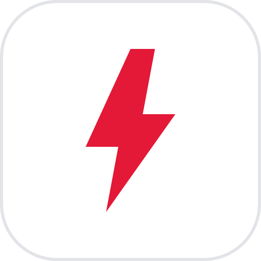
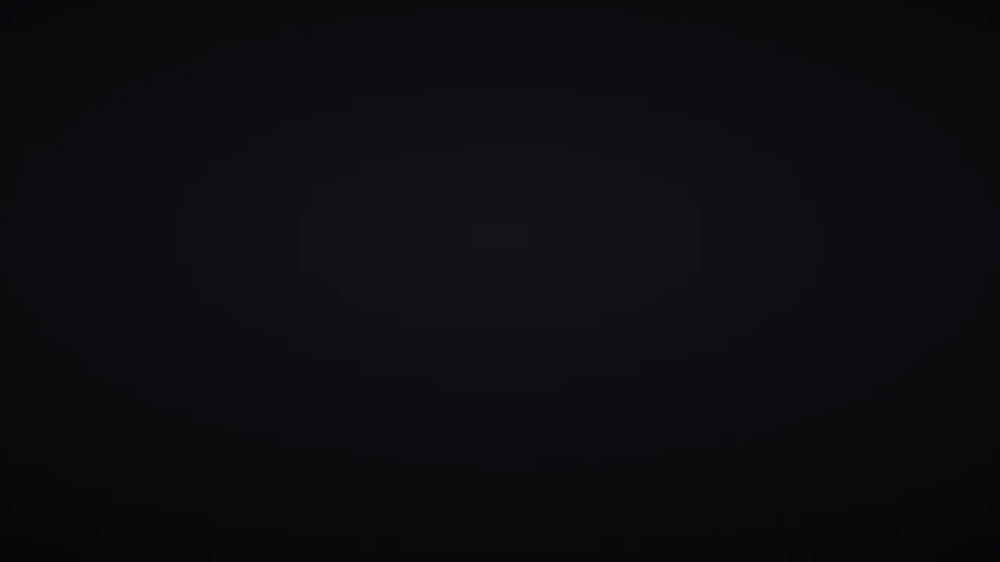
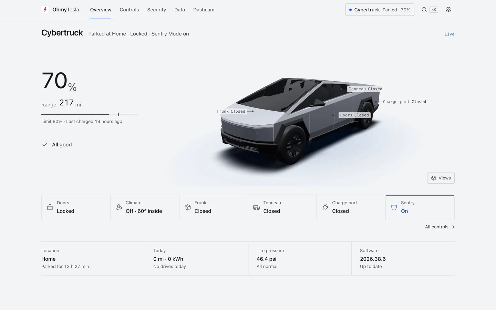
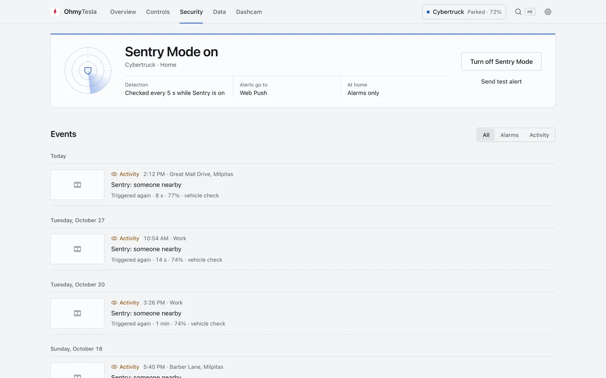
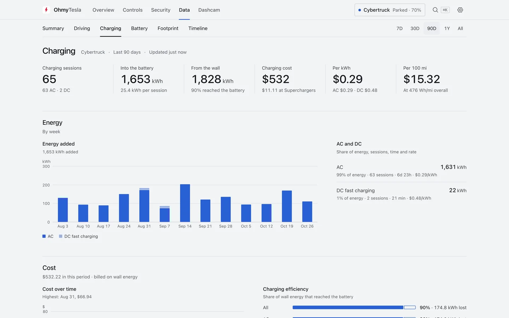
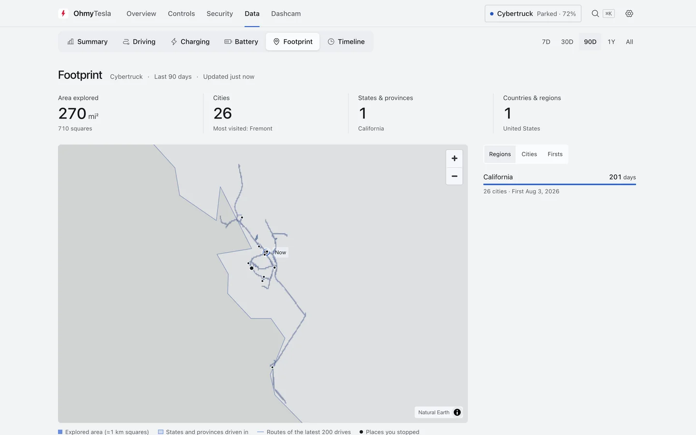
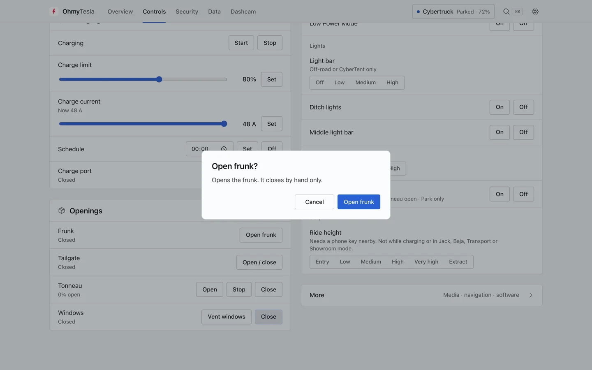
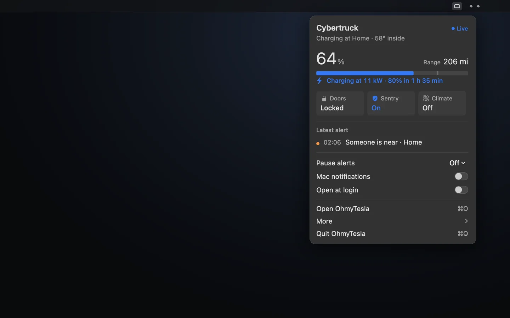

<div align="center">



# OhmyTesla

**Your Tesla, your data, on your own machine.**<br>
Live status and controls, Sentry alerts on your phone, every drive and charge, and your dashcam — in one self-hosted app.

[](https://github.com/ChenFangfc/OhMyTesla/releases/latest/download/OhmyTesla-arm64.dmg)
[](https://github.com/ChenFangfc/OhMyTesla/releases/latest)
[](LICENSE)
[](README.zh-CN.md)

**[Download for Mac](https://github.com/ChenFangfc/OhMyTesla/releases/latest/download/OhmyTesla-arm64.dmg) · [Run with Docker](#docker) · [Phone alerts](#phone-alerts) · [Docs](#docs)**



<sub><a href="https://github.com/ChenFangfc/OhMyTesla/releases/latest/download/ohmytesla-film.en.mp4"><b>▶ The film in full quality (0:31)</b></a></sub>

</div>

---

## What it does

<table>
<tr>
<td width="50%"><br><b>Overview.</b> A true-scale 3D Cybertruck that shows what is open, locked or charging, with the place in words.</td>
<td width="50%"><br><b>Sentry.</b> An intrusion reaches your phone in seconds. Routine events stay in the app.</td>
</tr>
<tr>
<td><br><b>Data.</b> Every drive and charge, costs from your own tariff, battery health over time.</td>
<td><br><b>Footprint.</b> Every road you've driven, on one lifetime map.</td>
</tr>
<tr>
<td><br><b>Controls.</b> Climate, charging, locks, windows, tonneau. Risky commands ask first.</td>
<td><br><b>Mac app.</b> Status and quick settings in the menu bar. No Docker.</td>
</tr>
</table>

Also: dashcam clips read straight off the USB drive and matched to drives and Sentry events, an AI connector ([MCP](docs/MCP.md)) that answers questions from your own data, and English or Chinese throughout. Data collection is [TeslaMate](https://github.com/teslamate-org/teslamate), unmodified.

## Install

### Mac

1. [Download the DMG](https://github.com/ChenFangfc/OhMyTesla/releases/latest/download/OhmyTesla-arm64.dmg) (Apple silicon, macOS 13+) and drag **OhmyTesla** to Applications.
2. First launch: right-click → **Open** (macOS 15+: System Settings → Privacy & Security → **Open Anyway**). The app isn't notarized yet.
3. Pick **Connect to my server** if one already runs at home (the app then needs about 40 MB with its window closed), or **Run on this Mac**. Then sign in to Tesla.

Running on the Mac needs no Docker: the whole stack idles at about 0.2% of one CPU core and 300 MB of memory.

### Docker

On any Linux or Mac machine with Docker:

```bash
git clone https://github.com/ChenFangfc/OhMyTesla && cd OhMyTesla
cp .env.example .env      # set OHMYTESLA_PASSWORD, e.g. openssl rand -base64 24
./omt up                  # → http://<this machine>:8800, user ohmytesla
```

Connect your car with `./tools/tesla_auth` (Tesla's own login page) and paste the two tokens into the setup page.

<details>
<summary>Everyday commands</summary>

| Command | Does |
|---|---|
| `./omt up` · `down` | start · stop (data kept) |
| `./omt status` | what is running, and whether data is flowing |
| `./omt logs` | follow logs (`./omt logs teslamate` for the collector) |
| `./omt restart` · `update` | after editing `.env` · after changing code |
| `./omt backup` | dump the database to `backups/` |

</details>

**Vehicle commands** (optional): Tesla only accepts signed commands from apps you approve. Set it up once in **Settings → Vehicle controls**, about 10 minutes — [docs/COMMANDS.md](docs/COMMANDS.md).

## Phone alerts

Only Sentry and major events reach your phone, one line each:

```text
🚨 Cybertruck — door opened while locked
Home · 9:41 PM
```

| Pushed | Kept in the app |
|---|---|
| Someone at the car, the alarm, a door opened while locked | Software updates, low battery, maintenance |
| The parked car moving (towed or driven off) | Data resumed, logger health |
| Low tire pressure, charging losing power | Sentry clips synced, routine checks |

Channels: ntfy (recommended), Bark (breaks through Do Not Disturb on iOS), Telegram, email, Web Push. Set them up in **Settings → Notifications**, then **Security → Send test alert**. Typical delay is about 10 seconds while Sentry is on, and 1–2 seconds with [Fleet Telemetry](docs/FLEET-TELEMETRY.md).

## Security

- Keep it on your home network or behind a VPN. Never port-forward it.
- The app refuses to serve without `OHMYTESLA_PASSWORD`. It can unlock your car.
- What each port exposes: [docs/SECURITY.md](docs/SECURITY.md).

## Docs

| | |
|---|---|
| [Quickstart](docs/QUICKSTART.md) | full walkthrough and troubleshooting *(Chinese)* |
| [Vehicle commands](docs/COMMANDS.md) | signed-command setup *(Chinese)* |
| [teslausb](docs/TESLAUSB.md) | the car's USB drive syncs footage by itself |
| [Fleet Telemetry](docs/FLEET-TELEMETRY.md) | 1–2 second alerts *(Chinese)* |
| [AI access (MCP)](docs/MCP.md) · [Let an AI install it](docs/AI-SETUP.md) | for Claude Code, Cursor and friends |
| [Mac app](packaging/macos/README.md) · [Architecture](docs/ARCHITECTURE.md) | how it's built *(architecture in Chinese)* |
| [Film source](promo/README.md) | the 30-second film, as code |

## License

[AGPL-3.0](LICENSE), like TeslaMate, which runs unmodified. Not affiliated with Tesla, Inc. or the TeslaMate project; Tesla and TeslaMate are trademarks of their owners. The bundled 3D model is CC BY 4.0 ([credits](services/hub/app/web/static/models/CREDITS.md)); icons are [Phosphor](https://phosphoricons.com) (MIT). Dashcam data decoding is an independent implementation of Tesla's published format.
