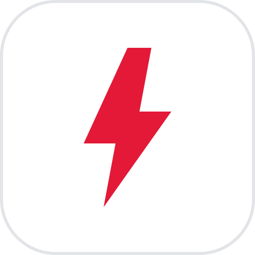
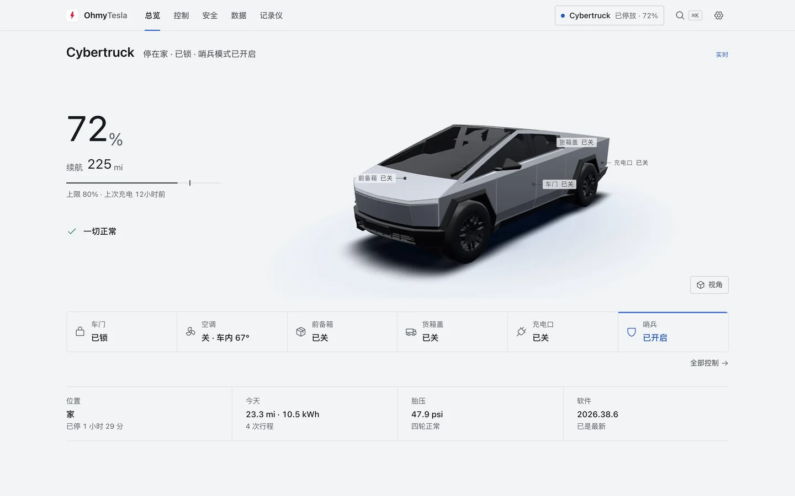
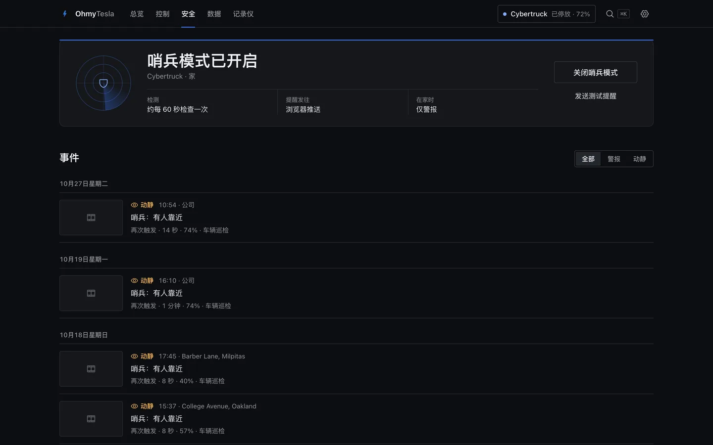
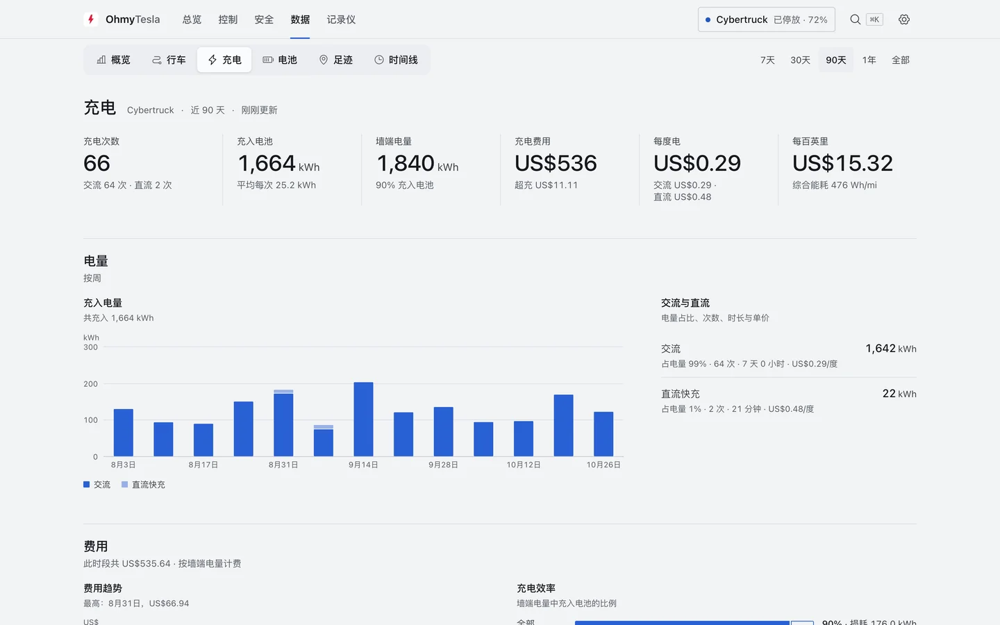
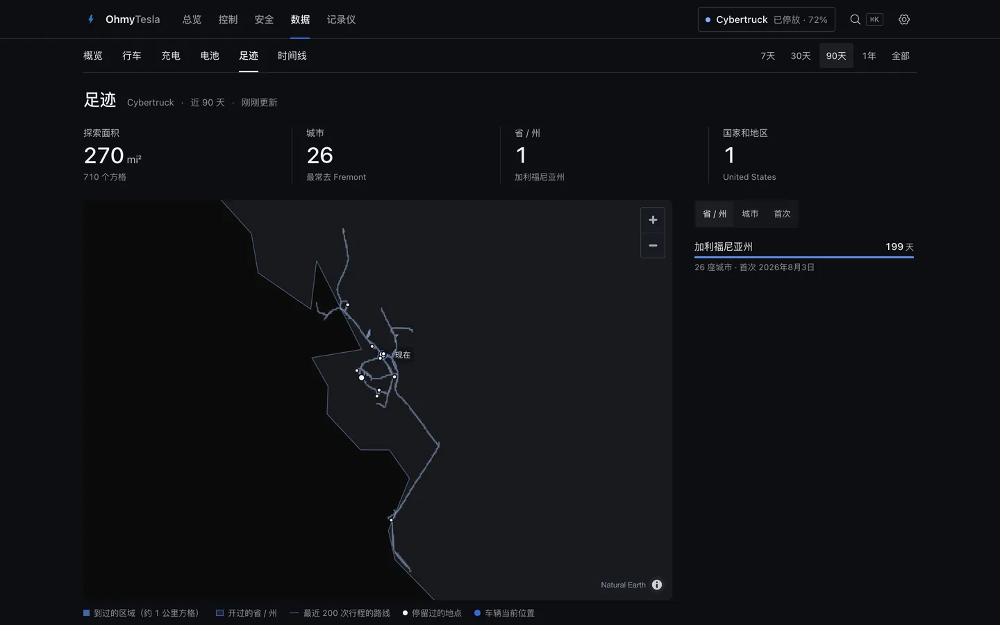
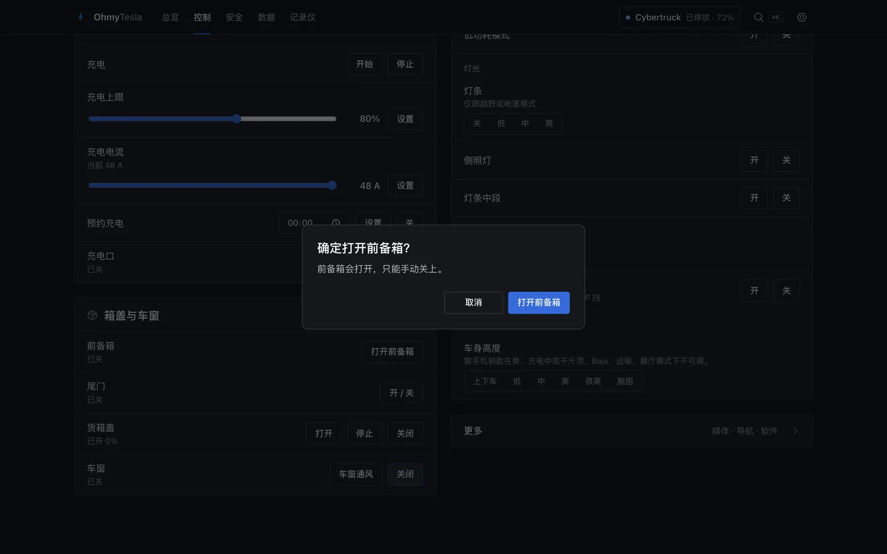
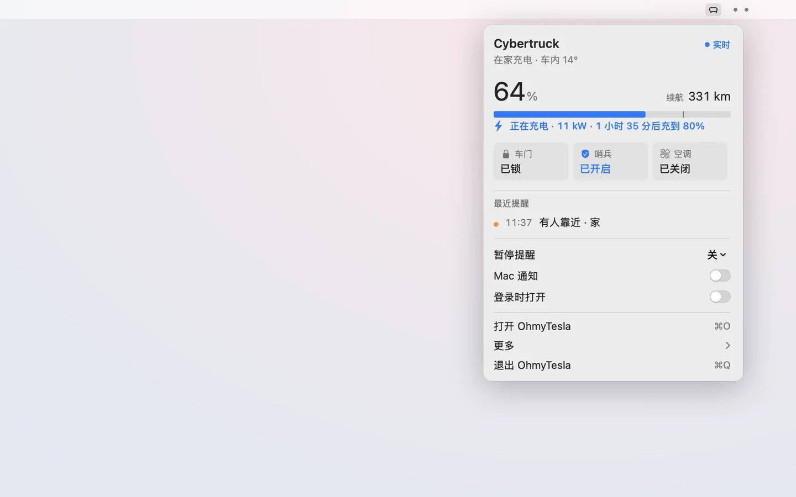

<div align="center">



# OhmyTesla

**你的车，你的数据，跑在你自己的设备上。**<br>
车况与远程控制、哨兵提醒推到手机、每段行程与充电、行车记录——一个自托管应用全部收齐。

[](https://github.com/ChenFangfc/OhMyTesla/releases/latest/download/OhmyTesla-arm64.dmg)
[](https://github.com/ChenFangfc/OhMyTesla/releases/latest)
[](LICENSE)
[](README.md)

**[下载 Mac 版](https://github.com/ChenFangfc/OhMyTesla/releases/latest/download/OhmyTesla-arm64.dmg) · [用 Docker 部署](#docker) · [手机提醒](#手机提醒) · [文档](#文档)**


<sub><a href="https://github.com/ChenFangfc/OhMyTesla/releases/latest/download/ohmytesla-film.zh.mp4"><b>▶ 观看高清完整版（0:31）</b></a></sub>

</div>

---

## 能做什么

<table>
<tr>
<td width="50%"><br><b>总览。</b>等比例 3D Cybertruck，哪里开着、锁没锁、是否在充电一眼可见，位置直接写成地名。</td>
<td width="50%"><br><b>哨兵。</b>有人动车，几秒内推到手机；日常琐事只留在应用里。</td>
</tr>
<tr>
<td><br><b>数据。</b>每段行程、每次充电，按你的电价算费用，电池健康长期可查。</td>
<td><br><b>足迹。</b>开过的每一条路，都在一张一生足迹地图上。</td>
</tr>
<tr>
<td><br><b>控制。</b>空调、充电、门锁、车窗、货箱盖；高风险操作先弹窗确认。</td>
<td><br><b>Mac 应用。</b>状态栏点一下看车况、改设置，不需要 Docker。</td>
</tr>
</table>

另外：行车记录仪直接读 U 盘、录像自动对上行程和哨兵事件；接入 AI（[MCP](docs/MCP.zh-CN.md)）用你自己的数据回答问题；全程中英双语。数据采集用的是原版 [TeslaMate](https://github.com/teslamate-org/teslamate)，未做任何修改。

## 安装

### Mac

1. [下载 DMG](https://github.com/ChenFangfc/OhMyTesla/releases/latest/download/OhmyTesla-arm64.dmg)（Apple 芯片，macOS 13 以上），把 **OhmyTesla** 拖进「应用程序」。
2. 首次打开：右键 → **打开**（macOS 15 以上：系统设置 → 隐私与安全性 → **仍要打开**）。应用暂未经过 Apple 公证。
3. 家里已有服务器就选 **连接已有服务器**（关掉窗口后只占约 40 MB 内存），否则选 **在这台 Mac 上运行**。然后[完成设置](#设置)。

在 Mac 上运行不需要 Docker：整套服务空闲时只占约 0.2% 单核 CPU、约 300 MB 内存。

### Docker

任何装了 Docker 的 Linux 或 Mac：

```bash
git clone https://github.com/ChenFangfc/OhMyTesla && cd OhMyTesla
./omt up                  # 第一次会生成 .env 和随机密钥，并打印登录密码
```

打开 `http://<这台机器>:8800`（用户名 `ohmytesla`），然后[完成设置](#设置)。

<details>
<summary>常用命令</summary>

| 命令 | 作用 |
|---|---|
| `./omt up` · `down` | 启动 · 停止（数据保留） |
| `./omt status` | 哪些服务在跑、数据是否在流动 |
| `./omt logs` | 跟踪日志（`./omt logs teslamate` 看采集器） |
| `./omt restart` · `update` | 改了 `.env` 后 · 改了代码后 |
| `./omt backup` | 把数据库导出到 `backups/` |

</details>

## 设置

第一次打开应用时会一步步带你做完。之后在 **设置 → 设置向导** 可以再打开。

| 步骤 | 怎么做 | 用时 |
|---|---|---|
| 1. 连上你的车 | 用 [tesla_auth](https://github.com/adriankumpf/tesla_auth/releases/latest)（电脑）或 [Auth app for Tesla](https://apps.apple.com/us/app/auth-app-for-tesla/id1552058613)（iPhone）登录 Tesla，把拿到的两个令牌贴进应用 | 2 分钟 |
| 2. 手机提醒 | **iPhone**：安装 [Bark](https://apps.apple.com/app/id1403753865)，复制它显示的地址（`https://api.day.app/…`），贴进应用，点 **保存并测试**。**安卓**：用 [ntfy](https://ntfy.sh)，在 **设置 → 通知** 里设置 | 2 分钟 |
| 可选：车辆控制 | 锁车、空调、开前备箱等。在 [developer.tesla.com](https://developer.tesla.com) 建个应用（要绑卡，一辆车的用量在每月免费额度内），按 **设置 → 车辆控制** 走完（[说明](docs/COMMANDS.md)） | 约 10 分钟 |
| 可选：1–3 秒的哨兵提醒 | 接入 Fleet Telemetry。付费中转最省事；自建免费，但要公网 IP、域名和证书（[说明](docs/FLEET-TELEMETRY.md)） | 中转约 10 分钟 |

密码只交给 Tesla；令牌加密保存在你自己的设备上。

## 手机提醒

只推哨兵和重大事件，一行说清：

```text
🚨 Cybertruck — 锁车时车门被打开
家 · 21:41
```

| 推送到手机 | 只留在应用里 |
|---|---|
| 有人靠近、警报响起、锁车时门被打开 | 软件更新、电量低、保养提醒 |
| 停着的车被移动（拖走或开走） | 数据恢复、采集器状态 |
| 胎压低、充电功率异常下降 | 哨兵录像已同步、例行检查 |

渠道：iPhone 用 **Bark**（推荐：推送显示 OhmyTesla 图标，警报在静音时也会响），安卓用 **ntfy**，另有 Telegram、邮件、Web Push。在 **设置 → 通知** 里配置，点 **发送测试** 试一下。哨兵开启时通常 5 秒左右到达，接入 [Fleet Telemetry](docs/FLEET-TELEMETRY.md) 后 1–3 秒。

## 安全

- 只在家庭网络或 VPN 后使用，不要做端口转发。
- 没设 `OHMYTESLA_PASSWORD` 时应用拒绝服务——它能解锁你的车。
- 每个端口暴露什么：[docs/SECURITY.zh-CN.md](docs/SECURITY.zh-CN.md)。

## 文档

| | |
|---|---|
| [快速上手](docs/QUICKSTART.md) | 完整流程与排错 |
| [远程控制](docs/COMMANDS.md) | 签名指令设置 |
| [teslausb](docs/TESLAUSB.md) | 车上 U 盘自动同步录像 *（英文）* |
| [Fleet Telemetry](docs/FLEET-TELEMETRY.md) | 1–3 秒到达的提醒 |
| [AI 直查（MCP）](docs/MCP.zh-CN.md) · [让 AI 替你装](docs/AI-SETUP.zh-CN.md) | 给 Claude Code、Cursor 等使用 |
| [Mac 应用](packaging/macos/README.md) · [架构](docs/ARCHITECTURE.md) | 实现细节 *（Mac 应用文档为英文）* |
| [宣传片源码](promo/README.md) | 用代码生成的 30 秒短片 |

## 许可

[AGPL-3.0](LICENSE)，与原版运行的 TeslaMate 相同。与 Tesla, Inc. 及 TeslaMate 项目均无关联；Tesla 与 TeslaMate 是其各自所有者的商标。内置 3D 车模为 CC BY 4.0（[署名](services/hub/app/web/static/models/CREDITS.md)），图标来自 [Phosphor](https://phosphoricons.com)（MIT）。行车记录仪数据解码依据 Tesla 公开的格式独立实现。
